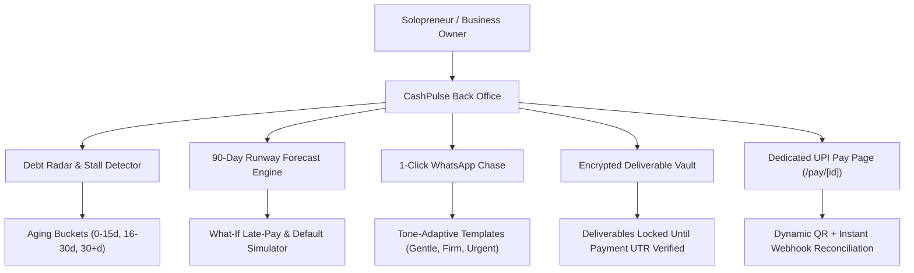

# CashPulse: The One-Person Back Office

[](https://nextjs.org/)
[](https://www.typescriptlang.org/)
[](https://tailwindcss.com/)
[](https://cashpulse-eight.vercel.app)
[](https://opensource.org/licenses/MIT)

> **Eliminate cash flow anxiety, detect stalling client debts, simulate 90-day runways, and recover unpaid dues via WhatsApp in 1 click.**  
> Built for solopreneurs, independent consultants, tutors, and boutique clinics.

---

## 🚀 Live Demo & Links

- **Live Web Application**: [https://cashpulse-eight.vercel.app](https://cashpulse-eight.vercel.app)
- **Demo Video Walkthrough**: `cashpulse_demo_walkthrough.mp4` (Included in repository root)
- **Problem Statement**: Codebenders ACE Builders' Hackathon 2026 — *Problem Statement 1: "The One-Person Back Office"*

---

## 💡 The Problem

Solo professionals and small business operators in India bleed hours and revenue managing their finances on WhatsApp, paper registers, and complex spreadsheets:
1. **Uncertain Cash Runway**: "Will I have enough balance to pay office rent and contractor fees next month?"
2. **Stalling Debt & Awkward Chases**: Invoices sit overdue for 30+ days because asking clients for money feels uncomfortable and confrontational.
3. **Unprotected Deliverables**: Freelancers hand over final source files or high-resolution designs before getting paid, losing all leverage.
4. **Scattered Records**: No single ledger linking bank receipts, GST breakdowns, and UTR transaction codes for tax audits.

---

## ⚡ The Solution: CashPulse

CashPulse replaces manual registers with a proactive, intelligent financial control center:



---

## 🌟 Key Capabilities & Modules

### 1. Multi-Persona Business Engine
Switch instantly between 3 realistic, pre-configured solopreneur profiles:
- 🎨 **Freelance UI/UX Designer**: High-ticket client projects, milestone retainer invoices, Figma & design file assets.
- 📚 **NEET Physics Tutor & Coaching Center**: Batches, parent fee schedules, monthly assistant teacher payouts.
- 🏥 **Dental & Physio Clinic**: Treatment balances, implant lab vendor dues, surgical assistant payouts.

### 2. Debt Radar & Aging Buckets
- Real-time categorisation into **Current (0-15d)**, **Aging (16-30d)**, and **Critical (30+d)**.
- **Client Karma Rating (A to F)**: Automatically computes payment reliability scores based on historical payment timeliness.
- **Stall Detector**: Highlights repeat slow-payers and suggests deposit policies before starting new projects.

### 3. 90-Day Predictive Runway & What-If Simulator
- Interactive area chart calculating projected daily balances: `Current Cash + Expected Invoices - Scheduled Recurring Expenses`.
- **What-If Scenario Sliders**: Test what happens if a major client pays 15, 30, or 45 days late, or completely defaults.
- Live alerts and mitigation recommendations (e.g. *"Delay contractor payout by 7 days or offer 3% early-pay cash discount"*).

### 4. Bad Day Protocol (Emergency Triage)
- When cash is critically tight, the **Bad Day Protocol** provides a single-screen triage mode to prioritize and blast urgent reminders to all overdue debtors in seconds.

### 5. Encrypted Milestone Deliverable Vault
- Link final delivery assets (e.g. GitHub repos, Figma prototypes, drive folders) to specific invoices.
- Assets remain encrypted and locked behind a verified payment gate until the client settles the invoice.

### 6. Dedicated Client UPI Payment Portal (`/pay/[id]`)
- Shareable client-facing payment links with dynamic UPI QR code generator (`upi://pay?pa=...`).
- Built-in instant UTR verification simulation that automatically unlocks deliverable files and updates the ledger.

### 7. AI Quick Paste & Voice Invoice Generator
- Paste raw client WhatsApp chats (e.g. *"Bhai 45k ka invoice bhej de logo design ka due Friday"*).
- The natural language parser extracts client, project, amount, and due date automatically.
- Includes browser voice dictation for hands-free invoice creation.

### 8. Fullstack REST APIs & Webhooks
Production-ready serverless API endpoints:
- `GET /api/health` — System uptime and version check.
- `GET /api/invoices` & `POST /api/invoices` — Query and create invoices programmatically.
- `POST /api/webhooks/upi` — Automated webhook endpoint for payment gateway and bank reconciliation.
- `POST /api/ai/parse-chat` — Text extraction engine for chat logs.
- `GET /api/export/ca-ledger` — Chartered Accountant-ready CSV export with GST and bank UTR fields.

---

## 🛠️ Tech Stack & Architecture

- **Framework**: Next.js 16 (App Router, Turbopack)
- **Language**: TypeScript 5 (Strict type checking)
- **Styling**: Tailwind CSS 4 with custom light theme and subtle ambient gradients
- **Data Visualizations**: Recharts
- **Icons**: Lucide React
- **QR Engine**: qrcode
- **State Management**: Zero-dependency resilient browser storage with singleton server-side persistence

---

## 💻 Getting Started Locally

### Prerequisites
- Node.js 18.x or 20.x+
- npm or pnpm

### Installation
```bash
# 1. Clone the repository
git clone https://github.com/AAKASH-CODES-CODE/cashpulse.git
cd cashpulse

# 2. Install dependencies
npm install

# 3. Start development server
npm run dev
```

Open [http://localhost:3000](http://localhost:3000) in your browser.

### Quality Verification Commands
```bash
# Run TypeScript compilation check
npx tsc --noEmit

# Run ESLint verification
npm run lint

# Create production build
npm run build
```

---

## 📱 Mobile-First Responsive Design

CashPulse is built from the ground up for mobile devices, featuring:
- Collapsible responsive navigation bar and mobile bottom quick-bar.
- Native tap bounce micro-interactions (`active:scale-98`).
- Seamless radial vignette focus tour that adapts smoothly between desktop and smartphone viewports.

---

## 📄 License

This project is licensed under the [MIT License](LICENSE).
